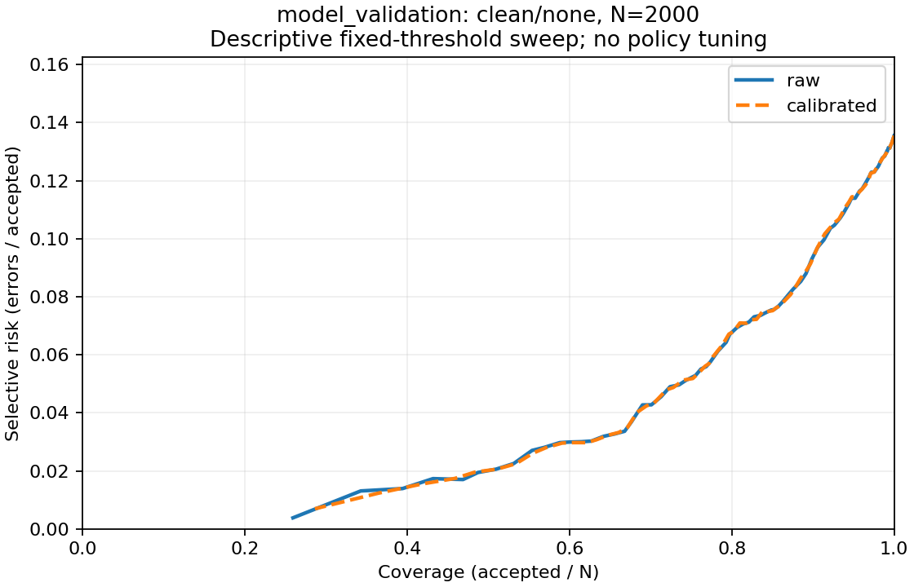

# Calibration, rejection and metric handoff — Issue #3

Implemented for Mysteri0K1ng with Codex assistance on 12 October 2026. This report covers the work package, development evidence and the integration contract for MedvAx-AI. The complete final-test experiment and its conclusions belong to Issue #4; no real final-test logits were produced or evaluated here.

## Frozen inputs and numerical choices

The input checkpoint is `artifacts/model/linear_head.npz`, SHA-256 `9a02afa9f5595437a35dcac020ccdf9fafc1944088948bdd781cb03f92eb107c`. Both fitting inputs refer to that head, the same model configuration and seed-42 split-manifest identifier `0a731713a64cd147594f806f19eff3e0ceaf7c9db1e1c0f8c116cf25787df2be`. All rows are checked against exact ordered manifest IDs and labels, alongside the NPZ hash and sidecar metadata.

`configs/evaluation.yaml` declares the optimizer and tolerances before test reporting. The temperature objective is full-set mean NLL on 1,500 clean calibration examples. Search operates in log(T), includes the initial log(T)=0 objective, and uses deterministic golden-section minimization within [-5,5] (positive T approximately 0.006738–148.413). This interval is a numerical search limit, not a setting selected from final-test performance. NLL is convex in inverse temperature; positive inverse temperature is monotone in log(T), so the one-dimensional objective is unimodal. Search stops at interval width ≤1e-8 or 200 iterations. The allowed objective worsening tolerance is 1e-10.

Exhaustion, a search-boundary optimum, or invalid/worsened numerical objective is recorded as a failed fit, with explicit T=1 fallback. An interior optimum that offers no improvement retains T=1. Nonfinite input logits and wrong split provenance are rejected before fitting. Model parameters are never updated.

The saved fit converged in 44 iterations/48 objective evaluations:

| Calibration quantity | Value |
|---|---:|
| Temperature | 0.9561687801607236 |
| NLL before | 0.4255893732 |
| NLL after | 0.4250433196 |
| Argmax unchanged | True |

T<1 slightly sharpens probabilities here. It is possible for another dataset to need T>1, fail fitting, or show no useful calibration improvement. The small calibration-objective decrease supports the fit's correctness; it does not establish a broad reliability claim.

## Threshold selection and feasibility

The clean policy-selection split has 1,500 examples and is disjoint from calibration. The frozen rule accepts confidence ≥tau, examines tau=0.00,0.01,…,1.00, and requires empirical accepted accuracy ≥0.90 with coverage ≥0.20. Maximum accepted count wins; the smallest numeric tau breaks equal-count ties. No interpolation between grid points or post-test target adjustment occurs. An infeasible target uses tau=0.80 with status `infeasible_fallback_tradeoff` and its actual counts, including null accuracy/risk if it accepts nothing.

| Confidence | Tau | Feasible | Accepted | Correct accepted | Coverage | Accepted accuracy |
|---|---:|---|---:|---:|---:|---:|
| Raw | 0.56 | Yes | 1,300 | 1,170 | 0.866667 | 0.900000 |
| Calibrated | 0.57 | Yes | 1,299 | 1,170 | 0.866000 | 0.900693 |

The flags describe the policy split only. A later corruption or unseen population may violate either target. `artifacts/policy.json` saves the rule, targets, feasible-grid-point count, fallback, exact accepted/correct counts, input hashes, T, temperature-file hash and a pre-test lock flag. `artifacts/temperature.json` records the optimizer, initial value, bounds, convergence, objective and calibration provenance. Loading also verifies the current checkpoint, data/model/evaluation settings, protocol and original fitting inputs.

## Shared metrics and controlled comparisons

`src/metrics.py` uses float64 log-softmax, centering logits before temperature division. NLL is the mean negative log probability of the true label over all N images, including rejected ones. Primary ECE also includes every image and uses 15 equal-width bins `[0,1/15)`, …, `[14/15,1]`; exact interior boundaries enter the bin on their right, confidence 1 enters the last bin, and empty bins contribute zero. ECE depends on binning and is not a guarantee for an individual confidence.

Full-set accuracy uses latent argmax predictions before rejection. Coverage is accepted/N; rejection rate is 1−coverage. Accepted accuracy is correct accepted/accepted; selective risk is 1−accepted accuracy. When nothing is accepted, both are JSON null/blank CSV fields. Full-set metrics remain defined. A/C accept all rows independently of tau; accepted accuracy equals full-set accuracy. Per-class results carry population/accepted/correct counts and coverage, with null rates for an absent class.

`src/rejection.py` implements A (raw/all), B (raw/rejection), C (calibrated/all), D (calibrated/rejection). It preserves each latent class and returns `REJECT` for deferred user-facing outputs. Rejection is never treated as a ground-truth class.

These are clean **model-validation development** results on the identical 2,000 saved logit rows:

| Condition | Full accuracy | NLL, all images | ECE, all images | Accepted / correct accepted | Coverage | Accepted accuracy | Selective risk |
|---|---:|---:|---:|---|---:|---:|---:|
| A | 0.8645 | 0.424481 | 0.024649 | 2,000 / 1,729 | 1.0000 | 0.864500 | 0.135500 |
| B | 0.8645 | 0.424481 | 0.024649 | 1,770 / 1,619 | 0.8850 | 0.914689 | 0.085311 |
| C | 0.8645 | 0.424384 | 0.023199 | 2,000 / 1,729 | 1.0000 | 0.864500 | 0.135500 |
| D | 0.8645 | 0.424384 | 0.023199 | 1,770 / 1,617 | 0.8850 | 0.913559 | 0.086441 |

A→B shows less error among accepted images while withholding 230 predictions. A→C isolates the probability change, with exactly the same labels and full accuracy. C→D isolates rejection using calibrated confidence. B and D happen to have identical coverage, but their accepted populations differ; their two-correct-image difference is not evidence that temperature changes classification accuracy. The original condition-A report agrees with the shared metrics to numerical precision and is preserved.

At retrospective top-50% coverage, raw and calibrated rankings each have 979/1,000 correct. At top-80%, raw has 1,492/1,600 versus calibrated 1,491/1,600. These diagnostic populations are chosen by ranking confidence with sample-ID ties resolved lexicographically. Nonintegral requested counts use ceil(N×coverage), and actual coverage is reported. This diagnostic is not a deployable operating threshold.



## Integration contract for Issue #4

Use `load_frozen_policy()` from `src/policy_artifacts.py` before any final evaluation. It validates the saved handoff without fitting. To evaluate a common cached logit array:

```python
from src.policy_artifacts import load_frozen_policy
from src.rejection import evaluate_policies, sensitivity_analysis, plot_risk_coverage

policy = load_frozen_policy()
comparison = evaluate_policies(
    logits, labels,
    temperature=policy["temperature"],
    raw_threshold=policy["raw"]["threshold"],
    calibrated_threshold=policy["calibrated"]["threshold"],
    class_order=policy["class_order"],
)
analysis = sensitivity_analysis(logits, labels, source_ids, temperature=policy["temperature"])
plot_risk_coverage(analysis, "results/figures/risk_coverage.png", title="Condition name, N=2000")
```

`comparison["metrics"]` contains four aggregate dictionaries; `comparison["decisions"]` contains condition-keyed latent predictions, raw/calibrated/active confidence, tau (null for A/C), accepted masks and user-facing outputs. `sensitivity_analysis` returns both confidence modes at all 101 identical numeric thresholds plus 50/80/100% ranking diagnostics. This supplies matched-numeric-threshold B–D comparisons and curves for clean or corrupted predictions without rerunning the backbone. The clean-fitted T and taus stay fixed across all ten conditions. Sensitivity on final-test data is descriptive; `select_threshold` rejects every split name except `policy_selection`.

Run `python scripts/analyze_policy_logits.py --logits PATH --output-dir DIR` for a checked clean/corrupted model-validation artifact. Later, `--allow-final-test` permits reporting a correctly declared final-test logit artifact only after the frozen-policy checks pass. The final runner must export the same `[N,10]`/ordered-ID contract and matching sidecar fields: split, corruption, severity, n, class_order, checkpoint/model-config/split hashes, final_test flag, NPZ hash. Each output directory represents one image condition and contains `metrics.json`, `metrics.csv`, `per_image.csv`, `threshold_sweep.csv`, `sensitivity.json`, `risk_coverage.png`. CSV decisions and aggregates share a deterministic run identifier; JSON links to input/policy hashes. Merge the ten condition outputs in Issue #4 to produce its 40-row final matrix, reliability figures and real severe-corruption class analysis.

Stored development outputs prove the interface before final testing. Final clean/corrupted results and failure examples remain the integrated experiment's responsibility; synthetic tests exercise all ten conditions and the final guard without exposing real test predictions.

## Review of Telman3000's leakage checks

Reviewed `assert_split_integrity` and `verify_manifest_directory` in `src/data.py`. They validate actual records and stored IDs, class balance, official train/test partitions, within/across-split uniqueness, file hashes and the master content hash. Corruption datasets retain source IDs/labels and stay within their source split. These controls prevent this experiment's induced split leakage; they cannot establish absence of duplicates in external ImageNet pretraining.

The new adversarial check replaces a training record with a same-class calibration record, preserving balance, then recomputes the split's IDs/content hash, file hash and master IDs/content hash. Verification still fails on actual cross-split overlap. Separate integration checks reject altered labels, ID order, wrong split, corrupt NPZ hash, changed checkpoint and corrupt fitting inputs before the optimizer runs. Frozen-policy checks detect later drift. No changes to split IDs or data algorithms were needed.

## Verification, runtime and Q&A

Tests include a hand-calculated metric fixture, ECE boundaries/empty bins, extreme-logit stability, invalid inputs, T=2 as an independently derived optimizer optimum, convergence/numerical/objective fallback, threshold inclusion/ties/infeasibility, zero acceptance, A/C equivalence, argmax preservation, deterministic ranking ties, fitting reproduction, leakage checks and checked clean/corrupt/final reporting. **All 83 tests passed**, including the existing data/corruption tests, in an isolated copy because those tests regenerate manifests; the committed experiment artifacts remain intact. Seven existing torchvision/NumPy dataset-load deprecation warnings were reported. Compilation and whitespace checks passed as well.

Development fitting used Windows 11, Python 3.13.4, NumPy 2.4.2, PyYAML 6.0.3, torch 2.14.0+cpu, torchvision 0.29.0+cpu, Pillow 12.1.0, matplotlib 3.10.8 and pytest 9.1.1. This is an additional tested environment for cached-logit analysis; the baseline's tested pins are preserved. Saved fit time is 0.02380 seconds, threshold selection 0.01503 seconds, and A–D/sensitivity calculation 0.015 seconds approximately (exact clock in `metrics.json`). These clocks exclude image inference and should not replace the baseline's measured end-to-end time. Installation/startup/plotting/file writes are excluded from the cached evaluation clock.

Team rehearsal prompts:

- **Why five partitions?** Training learns weights, model validation chooses the checkpoint, calibration learns T, policy selection chooses tau, final test reports outcomes. Reusing any fitting split for final claims weakens the independent comparison.
- **Can calibration improve full accuracy?** Positive scalar T preserves argmax; A and C must have identical full accuracy. Confidence and likelihood can change.
- **Why optimize NLL rather than ECE?** NLL is a smooth proper scoring objective. ECE is a bin-dependent diagnostic; reducing fitting NLL need not reduce held-out ECE.
- **Does the 90% target guarantee 90% test accuracy?** No. It is empirical on 1,500 policy examples and can fail under sampling variation or corruption.
- **What if all predictions are rejected?** Coverage is zero, accepted accuracy/risk are undefined, and full-set NLL/ECE remain available.
- **Why not pick the best final-test curve point?** That would tune on the reporting set. Keep clean-fitted taus; describe the curve without adapting them.
- **Why can B and D differ at the same coverage?** Temperature may change the multiclass confidence ranking, changing the accepted images while preserving every class prediction.
- **What remains for the final report?** Run the locked 40-row matrix, inspect clean/severe per-class coverage, quantify at least three actual failures and distinguish hypotheses from evidence.
