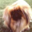

# Final failure analysis

These cases are selected from the frozen final run after evaluation. They explain observed limitations; they did not change T, thresholds, checkpoint or corruption settings.

Run: `a9d534f5ff01664d`. T=0.95616878; raw tau=0.56, calibrated tau=0.57.

## Selection and counts

D only; highest calibrated confidence, then source ID and corruption lexicographically.

Counts are occurrences in condition D. Clean categories each have denominator 2,000; corruption damage considers 6,000 image variants (three severe corruptions), with paired clean D decisions. Counts of unique source images are also reported.

- confident_wrong_accepted: 160 candidate rows / 160 unique source images.
- correct_but_rejected: 103 candidate rows / 103 unique source images.
- corruption_damage: 1305 candidate rows / 986 unique source images.

## 1. Confidently wrong and accepted

 

Source **test:5806**, final_test; true **airplane**, observed prediction **ship**. Condition **clean/none**, parameter None. Raw confidence **0.998194**, calibrated **0.998673**, D threshold **0.57**, decision **ACCEPT**.

Paired clean prediction: **ship**, raw confidence 0.998194, calibrated 0.998673; ACCEPT.

**Likely cause / hypothesis:** The airplane has a small horizontal silhouette against a watery-looking background. Ambiguous shape and background cues at 32x32 may favor ship in the frozen features. This is a visual hypothesis, not proof of internal model reasoning.

**Limitation / next test:** Compare foreground/background masking and nearest development features with the checkpoint fixed; a selected image alone cannot reveal internal model reasoning.

Image hashes: clean `02717bcf4a31348090c91cebb8cfc2631ce385d2abb0233de8afcba95f2cfe90`, observed `02717bcf4a31348090c91cebb8cfc2631ce385d2abb0233de8afcba95f2cfe90`.

## 2. Correct latent class, unnecessarily rejected

 

Source **test:2998**, final_test; true **dog**, observed prediction **dog**. Condition **clean/none**, parameter None. Raw confidence **0.549534**, calibrated **0.568358**, D threshold **0.57**, decision **REJECT**.

Paired clean prediction: **dog**, raw confidence 0.549534, calibrated 0.568358; REJECT.

**Likely cause / hypothesis:** The tightly cropped frontal dog face lacks body context. The predicted dog remains correct, but calibrated confidence 0.568 is just below the frozen 0.57 threshold. This demonstrates the cost of rejection; the threshold was not changed after seeing the image.

**Limitation / next test:** Inspect the top class margins and a larger set of correct rejections; lowering the threshold would change coverage and must not be tuned on this test example.

Image hashes: clean `756b1d3e7fa9f17cb5deda3fd22edb508537a36b7e6af7dbd654c23fec16f12c`, observed `756b1d3e7fa9f17cb5deda3fd22edb508537a36b7e6af7dbd654c23fec16f12c`.

## 3. Correct clean decision becomes a wrong accepted decision

 

Source **test:4720**, final_test; true **ship**, observed prediction **airplane**. Condition **jpeg/severe**, parameter 15. Raw confidence **0.987883**, calibrated **0.990217**, D threshold **0.57**, decision **ACCEPT**.

Paired clean prediction: **ship**, raw confidence 0.846472, calibrated 0.856511; ACCEPT.

**Likely cause / hypothesis:** The small diagonal ship and its wake on blue water lose outline detail and gain visible block/band artifacts under JPEG quality 15. The same source changes from a correct accepted ship to a confidently wrong accepted airplane. Altered shape/wake cues are a plausible cause, not a demonstrated internal mechanism.

**Limitation / next test:** Repeat the paired analysis on development images across severities; isolate foreground detail and record confidence transitions without changing the locked policy.

Image hashes: clean `8061654940e93c2d35cc4ade786d310adc940c3631367644f7b1aa8c64f62a32`, observed `c6e02e10d70ed291bf02c997b9aa4203e8b93afd973c84145fa5b28fc6cde883`.
