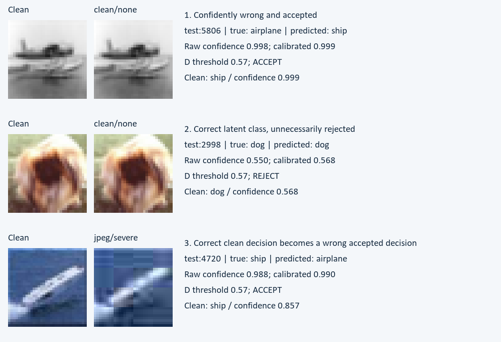

# Reliable Image Classification with Confidence Rejection

Introduction to Computer Vision | Final technical summary | 12 October 2026

Team: Aleksandr Medvedev, Telman Nuruzov, Leo Vesin, Nikita Shankin.

## 1. Problem and research question

Can a fixed CIFAR-10 classifier reduce errors among accepted predictions by rejecting low-confidence images, and does temperature scaling improve reliability? We measure the accuracy/coverage tradeoff on clean images and controlled blur, noise and JPEG variants. This is closed-set classification with an abstention output, not an out-of-distribution detector.

## 2. Dataset and preparation

CIFAR-10 has 60,000 RGB 32x32 images in ten classes: airplane, automobile, bird, cat, deer, dog, frog, horse, ship and truck. Seed 42 selects class-balanced, disjoint subsets: training 10,000; model validation 2,000; calibration 1,500; policy selection 1,500; final test 2,000 from the official test archive. Source IDs are committed and checked for overlap; each final class has 200 images. Native images are bilinearly resized to 256, center-cropped to 224 and normalized with ImageNet mean/std; there is no augmentation. Corruptions operate independently at native resolution: Gaussian blur radii 0.5/1/1.5, clipped Gaussian noise standard deviations 0.03/0.06/0.12, and JPEG qualities 70/40/15. Noise is deterministically seeded per source ID.

## 3. Method and controlled experiment

An ImageNet IMAGENET1K_V1 ResNet-18 backbone, including BatchNorm, remains frozen. Only a 512-to-10 linear head is trained using cached training features: cross-entropy, AdamW, learning rate 0.001, weight decay 0.0001, batch 256, 30 epochs. Epoch 30 minimizes model-validation NLL (0.4245; accuracy 86.45%). A uses raw confidence and always predicts; B uses raw confidence with rejection; C always predicts after temperature scaling; D combines scaling and rejection. All share the same checkpoint and predicted labels.

Temperature T=0.95616878 is fitted only on calibration logits. On the separate policy split, a fixed 0.01 threshold grid maximizes coverage subject to at least 90% accepted accuracy and 20% coverage; the smallest threshold breaks ties. Frozen raw/calibrated thresholds are 0.56/0.57; acceptance uses confidence >= threshold. No parameter is fitted or selected on final test. Twenty thousand image forwards supply 40 aggregate rows and 80,000 A-D decisions.

## 4. Quantitative results

Each row uses the same 2,000 final images. Full accuracy is shared by A-D; A/C coverage is 100%. B/D entries show accepted accuracy / coverage, both in percent. NLL and ECE use all images, including rejected predictions; ECE uses 15 equal-width bins.

| Image condition | Full acc. | B acc. / cov. | D acc. / cov. | Raw ECE | Cal. ECE |
|---|---|---|---|---|---|
| Clean | 85.05% | 90.85 / 88.00 | 90.90 / 87.90 | 0.0201 | 0.0187 |
| Blur radius 1.5 | 22.55% | 32.42 / 36.40 | 31.81 / 38.35 | 0.2934 | 0.3093 |
| Noise std 0.12 | 16.20% | 17.46 / 45.25 | 17.40 / 46.85 | 0.3906 | 0.4041 |
| JPEG quality 15 | 44.95% | 61.30 / 46.90 | 60.58 / 47.95 | 0.1264 | 0.1399 |

Clean D accepts 1,758 images, including 1,598 correct. Clean raw/calibrated NLL is 0.424013069 / 0.424012904. The full ten-condition table, per-class counts, reliability diagrams and 101-point raw/calibrated sweeps are in the repository.

<!-- pagebreak -->

## 5. Interpretation and sensitivity

Clean D improves accepted accuracy by 5.85 percentage points over A while rejecting 12.10% of images. It still accepts 160 errors and rejects 103 correct predictions. Calibration changes clean ECE by only 0.00141 and scarcely changes NLL; it cannot improve the argmax classification accuracy. Under severe corruptions, clean-fitted temperature sharpens confidence and worsens ECE/NLL. The 90% policy-split target is not a guarantee under distribution shift. Threshold curves trade coverage for selective risk; raw/calibrated curves nearly overlap, and severe noise remains unreliable. These final-test sweeps are descriptive only. One seed, a small subset and custom corruptions limit generalization; this is not a CIFAR-10-C benchmark or a safety guarantee.

## 6. Three observed failures and likely causes

1. test:5806: airplane becomes ship, calibrated confidence 0.9987, accepted. The small horizontal silhouette and watery-looking background may favor ship features. High confidence does not establish correctness.

2. test:2998: dog is correct, confidence 0.5684, rejected at 0.57. The cropped frontal face lacks body context; a small margin below the threshold discards a useful prediction.

3. test:4720: clean ship is correct and accepted (0.857); JPEG quality 15 becomes airplane and remains accepted (0.990). Blocking and lost ship/wake detail plausibly distort shape cues. The paired change is observed; internal causation is unproven.

Cases are selected deterministically from D, not sampled for prevalence. The severe-corruption damage category has 1,305 variant occurrences among 6,000 severe variants, covering 986 unique sources. Explanations are hypotheses; foreground masking, development-set margin checks and paired severity studies are follow-up tests, not completed interventions.

## 7. Reproducibility and runtime

Run a9d534f5ff01664d records checkpoint, split, policy, code and artifact hashes. Final evaluation used Windows 11, Python 3.13.13, PyTorch 2.14.0 CPU, Ryzen 7 5800H, about 16 GiB RAM, eight threads and inference batch 64. Timed image processing was 445.99 s for 19,360 images: fetch, corruption, hashing, preprocessing, backbone and head; the first 64 per condition, archive setup/download and weight loading are excluded. This machine-specific clock included ordinary background load. Original M4 Pro/MPS training measured 25.45 s feature extraction and 0.51 s head training; these are separate clocks. A fresh environment repeated all 20,000 image forwards with identical logits and six tables/decision/figure artifacts byte-for-byte; 98 tests and independent NumPy checks verified all aggregate metrics and 80,000 decisions. The local demo executes the saved model on pixels. See README for setup, checked-cache replay and a full image inference path. Repository: [MedvAx-AI/project](https://github.com/MedvAx-AI/Reliable-Image-Classification-with-Confidence-Rejection).

## 8. Contributions and references

Telman Nuruzov (Telman3000): dataset, manifests, corruptions and leakage checks. Leo Vesin (LeoVesinML): frozen model, head training, checkpoint/reload and training clocks. Nikita Shankin (Mysteri0K1ng): metrics, calibration, rejection, sensitivity and policy provenance. Aleksandr Medvedev (MedvAx-AI): integrated final evaluation, independent result checks, figures, failures, live demo and report/slides. Coding assistants supported implementation and review; these artifacts do not certify each student's independent understanding. References: [CIFAR-10](https://www.cs.toronto.edu/~kriz/cifar.html), [torchvision ResNet-18](https://docs.pytorch.org/vision/main/models/generated/torchvision.models.resnet18.html), [Guo et al., ICML 2017](https://proceedings.mlr.press/v70/guo17a.html).
